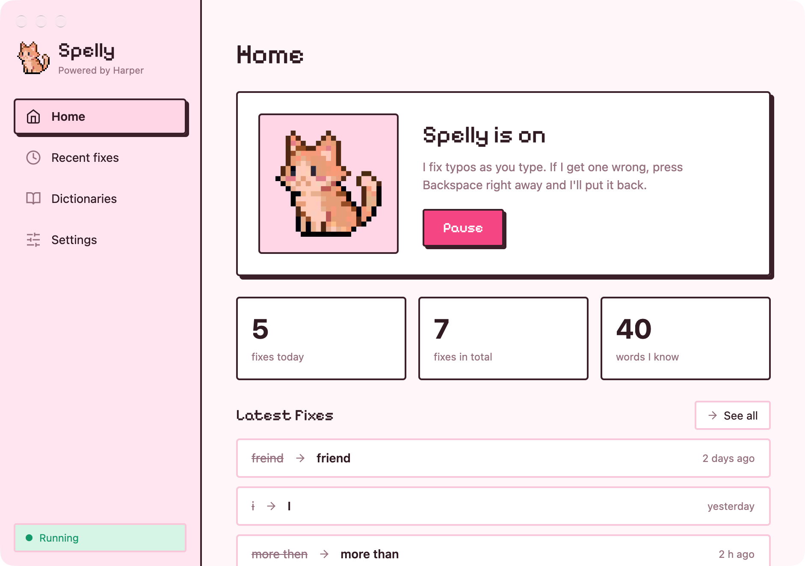
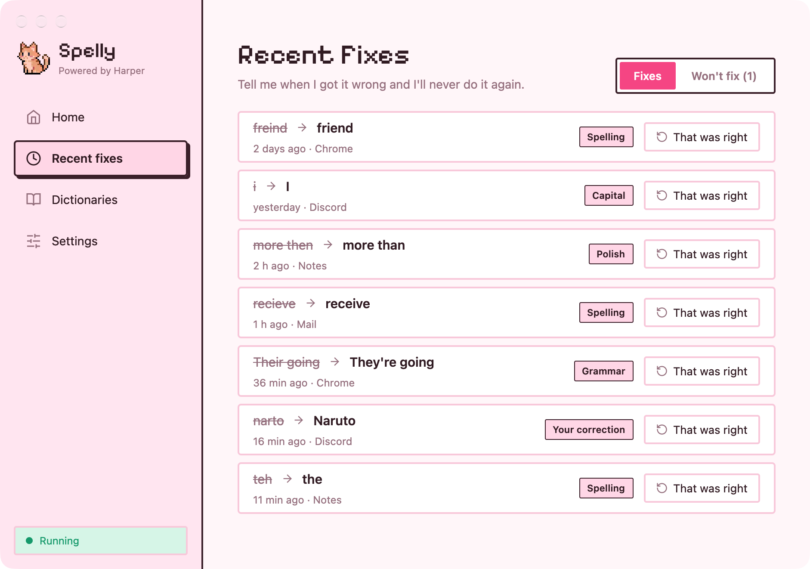
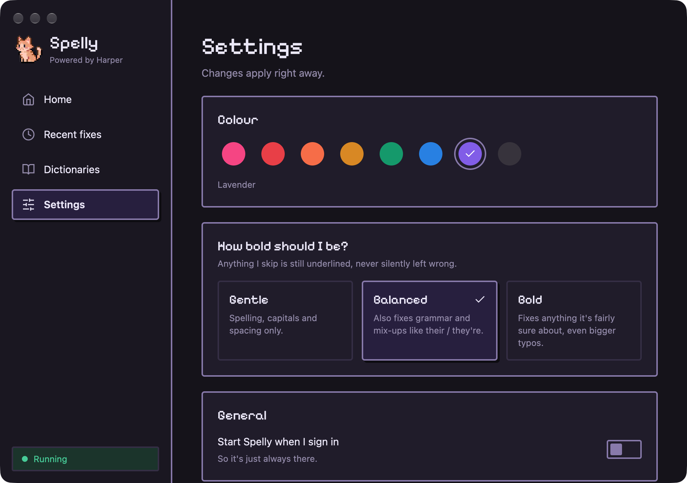

<div align="center">


# Spelly

**Type however you type. Spelly quietly fixes it.**

Forced autocorrect for Windows and macOS. Backspace puts back what you wrote.

<sub>Powered by <a href="https://github.com/Automattic/harper">Harper</a></sub>

<br />


&nbsp;



&nbsp;


</div>

---

## What it does

Finish a word and Spelly fixes it on the spot: spelling, spaces, punctuation, capitals, and the words that sound alike (*their / they're*, *then / than*). No suggestion popups. If it was right the first time, press **Backspace** and your original comes back, and Spelly leaves that word alone from then on, like a phone keyboard. Anything it isn't sure about gets a highlight instead of an edit.

Spelly runs in the background, in the tray (Windows) or menu bar (macOS), and keeps running when you close its window. Only **Quit** in the tray menu stops it. Opening Spelly from the Start Menu, Dock or Launchpad shows the window (starting Spelly first if needed), and signing in starts it silently with no window. **Open Spelly** in the tray menu shows the window:

- **Home**: on / pause, and what it fixed today.
- **Recent fixes**: tap *That was right* on anything it got wrong and it never does it again.
- **Dictionaries**: add the words and names it should leave alone. Extras are under *Advanced*.
- **Settings**: pick a colour (pink, or six others, or neutral), how bold to be, start at sign-in.

The window follows your system's light / dark setting.

## Install

| | |
| :--- | :--- |
| **Windows** | Run `Spelly-Setup.exe`. No admin needed. Tick "Start Spelly when I sign in" if you want it always on. |
| **macOS** | Open `Spelly-macOS.dmg`, drag Spelly to Applications, launch it, and allow it under **System Settings → Privacy & Security → Accessibility**. |

> [!NOTE]
> Builds are unsigned. If macOS says Spelly is damaged, run `xattr -cr /Applications/Spelly.app`. On Windows, SmartScreen may ask once: **More info → Run anyway**.

## Your files

Everything is plain text, so a person (or an agent) can edit it. **Advanced → Show file** in Dictionaries, or **Settings → Advanced → My Spelly files**, opens the folder:

- Windows: `%APPDATA%\Spelly`
- macOS: `~/Library/Application Support/Spelly`

```text
dictionaries/*.txt   word packs
settings.json        colour, boldness, ignored apps
log.jsonl            recent fixes
rejected.txt         "That was right" list
```

A pack is one entry per line:

```text
@kind proper         # names and titles (default); use `common` for ordinary words
Naruto               # a known word, canonical casing
narto -> Naruto      # always correct this
```

Starter packs: [`anime.txt`](dictionaries/anime.txt), [`indian-names.txt`](dictionaries/indian-names.txt). Edits are picked up within a second, no restart.

## How it's built

| Path | What |
| :--- | :--- |
| `crates/spelly-core` | The engine: packs, forced fixes, undo, typing state machine, settings. No OS calls, runs anywhere |
| `crates/spelly-win` | Windows background app: keyboard hook, tray, key injection |
| `crates/spelly-mac` | macOS background app: event tap, menu bar, key injection |
| `crates/spelly-ui` | The window, on [GPUI](https://www.gpui.rs). Our own components and theme, no webview |
| `harper/` | Our Harper fork: dictionary, grammar rules, context ranking |
| `packaging/` | Windows installer, macOS bundle, icon and mascot scripts |

The background app and the window are separate programs that only talk through the files above, so the always-on part stays small and the window can come and go.

## Known limits

- Fixes reach back three words, and context fixes need the next word: `their going` is caught once you type `to `.
- An unknown capitalized word mid-sentence is assumed to be a name and only highlighted.
- English only, via Harper.
- Windows and macOS builds are made by CI but haven't all been tried on real machines yet. Apps running as administrator can't be typed into by a normal-user Spelly.
- macOS skips password fields automatically (the OS hides them from Spelly); Windows checks for password boxes.
- Linux and mobile are not supported yet.

## Developing

```bash
cargo test                                   # engine + file formats
cargo run -p spelly-ui                       # the window
SPELLY_DATA_DIR=/tmp/spelly cargo run -p spelly-ui   # use a scratch data folder
```

`SPELLY_PAGE=recent|dicts|settings`, `SPELLY_THEME=light|dark` and `SPELLY_ADV=1` open the window on a given page, theme or with *Advanced* unfolded. Needs current stable Rust.

## Credits

Mascots are pixel-art cats, kept in `assets/mascot/source`. The display font is [Pixelify Sans](https://fonts.google.com/specimen/Pixelify+Sans) (SIL OFL 1.1). Spelling and grammar come from [Harper](https://github.com/Automattic/harper) (Apache-2.0).

## License

Apache-2.0. See [NOTICE.md](NOTICE.md).
